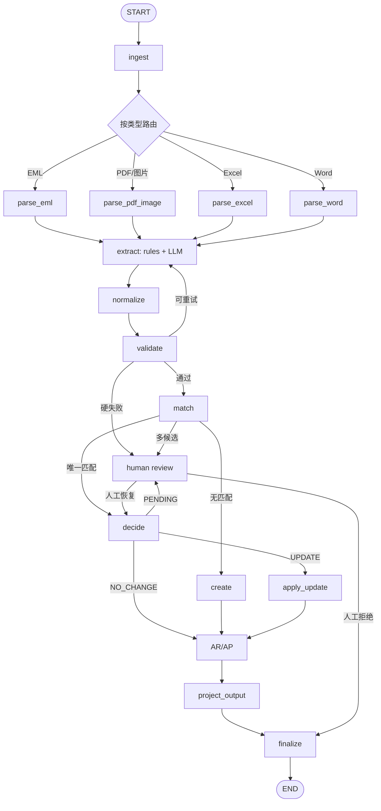

# 航运智能账单助手（Shipping Bill Agent）

PLTP「AI agent 笔试题」项目：读取 EML / PDF / 图片 / Excel / Word，抽取航运费用，匹配已有账单，输出 `CREATE / UPDATE / NO_CHANGE / PENDING_REVIEW` 决策，并生成严格合法的 JSON。

> 当前状态：**Phase 4 + API/Swagger 完成**。解析、抽取、校验、匹配、合并、AR/AP、严格 JSON 输出已接入 LangGraph；`interrupt/resume` 人工复核和 SQLite checkpoint 已实现；FastAPI + Swagger 可直接联调。Phase 5 收尾测试、文档和交付。

---

## 1. 设计要点

### 这是一个 workflow agent，不是 ReAct agent

- **LangGraph** 负责控制流（分支、重试、人工闸门、checkpoint）；
- **LangChain** 负责 LLM 调用和结构化输出；
- 业务判断（校验、匹配、合并、AR/AP 最终裁决）用**纯 Python**；
- LLM 只在抽取节点工作，路由由代码决定，保证可复现、可审计。

### 三层存储

```text
output.json      给下游财务系统的契约（严格 schema）
SQLite           内部账本：原始费用名、B/L、箱号、置信度、操作历史
AssetStore       原始文件 + OCR 原始 JSON + 抽取结果（本地 / OSS）
```

### 关键业务决策

| 主题 | 决策 |
|---|---|
| 敏感信息 | 只放 `.env`，`.env` 已被 `.gitignore` 忽略 |
| 记账主体 | 从 `.env` 的 `ACCOUNTING_ENTITY` 读取 |
| AR/AP | LLM 在抽取时给候选，代码按主体/签发方/接收方规则校验；冲突 → `PENDING_REVIEW` |
| Credit Note | 金额输出**负数**，同时保留 `document_type` |
| EML 主体不明 | **先落 SQLite**，进人工队列；人工确认后才输出，拒绝则只留库、不输出 |
| OCR URL | 通过 `OCR_PUBLIC_BASE_URL` / `ASSET_PUBLIC_BASE_URL` 提供；代码端不阻塞 |
| 输出字段 | 严格按题目 schema，不增加额外字段 |

### LLM 的边界

- **规则能取到的，绝不交给 LLM**：单号、B/L、箱号、日期、金额、币种、表头映射、匹配、AR/AP 最终裁决全部用代码。
- LLM 只在**信息模糊、规则难以判断**时介入：自由文本抽取、版式不稳定、AR/AP 候选。
- LLM 输出必须过 **Pydantic schema + 规则校验 + 交叉校验**。
- LLM 自评置信度、证据覆盖率、规则/LLM 冲突都会进入校验；冲突和低置信度 → `PENDING_REVIEW`。
- 人工复核通过 LangGraph `interrupt/resume` 完成，拒绝则不输出。

> 完整设计见 [`docs/harness.md`](docs/harness.md)。

---

## 2. 快速开始

```bash
cd D:/projects/shipping-bill-agent

python -m venv .venv
# Git Bash:
source .venv/Scripts/activate
# PowerShell:
# .venv\Scripts\Activate.ps1

pip install -r requirements.txt
pip install -e . --no-deps   # 让 python -m shipping_agent 可直接使用

cp .env.example .env          # 填 LLM key、记账主体等
python -m shipping_agent.cli init-db
python -m shipping_agent.cli run --input "data/samples/PDF 示例账单2.pdf"
pytest
```

如果不想 editable install：

```bash
export PYTHONPATH=src
python -m shipping_agent.cli init-db
```

---

### 样例数据说明

题目提供的样例包含业务信息，**不提交到仓库**（`data/samples/` 已在 `.gitignore` 中）。

使用方式：

1. 从题目提供的网盘下载样例，放到 `data/samples/`；
2. 依赖真实样例的测试会自动 skip，不会失败；
3. 合成 Excel/Word 测试数据已随仓库提供：`tests/fixtures/synthetic/`。

```text
data/samples/
├─ PDF 示例账单2.pdf
├─ PDF示例账单1.pdf
├─ 图片示例.png
└─ *.eml
```

## 3. 配置

所有敏感信息只在 `.env`：

```dotenv
LLM_PROVIDER=openai
LLM_MODEL=your-ark-endpoint-id     # 火山方舟推理接入点 ID，通常 ep- 开头
LLM_API_KEY=your-api-key
LLM_BASE_URL=https://ark.cn-beijing.volces.com/api/v3

ACCOUNTING_ENTITY=湃乐多（上海）航运科技有限公司
ACCOUNTING_ENTITY_ALIASES=湃乐多;Pilot Aiship Tech co., Ltd.;PLTP

OCR_URL=http://36.103.199.11:5002/process

# 资产库公网前缀；二选一，ASSET_PUBLIC_BASE_URL 优先
# 临时隧道地址由 scripts/host_file.py 自动写入，不要提交
ASSET_PUBLIC_BASE_URL=
OCR_PUBLIC_BASE_URL=          # 未设置 ASSET_PUBLIC_BASE_URL 时回退使用
```

`LocalAssetStore.url(asset_id)` 返回：

```text
{ASSET_PUBLIC_BASE_URL}/{storage_key}
# 例如 https://<临时隧道域名>/fa/fad.../original.pdf
```

所以 `ASSET_PUBLIC_BASE_URL` 必须指向 `ASSET_ROOT`（默认 `data/assets`）这一层，而不是项目根目录。

> 临时隧道域名每次启动都会变，不要把具体 URL 写死在 README、代码或提交记录里；`.env` 已被 `.gitignore` 忽略。

`.env` 不提交。`config/*.yaml` 只放可公开的别名表、阈值和默认值。

---

## 4. 命令行

```bash
python -m shipping_agent.cli version
python -m shipping_agent.cli init-db

# Phase 1：解析（不接 LLM，可按需关闭 OCR）
python -m shipping_agent.cli parse --input <file> [--input <file> ...] --no-ocr --out parse.json

# Phase 2：解析 + 规则抽取 + LLM 抽取 + 标准化 + 校验
python -m shipping_agent.cli extract --input <file> --no-ocr --no-llm --out extract.json

# Phase 3：匹配 + 合并 + AR/AP + 严格 JSON 输出
python scripts/seed_existing_bills.py --variant exact --reset
python -m shipping_agent.cli decide \
  --input "data/samples/PDF 示例账单2.pdf" \
  --no-ocr --no-llm \
  --out data/output/output.json \
  --summary-out data/output/decisions_summary.json

# Phase 4：完整 LangGraph（有 PENDING_REVIEW 会暂停）
python -m shipping_agent.cli graph \
  --input "data/samples/PDF 示例账单2.pdf" \
  --no-ocr --no-llm \
  --thread-id DEMO-1 \
  --out data/output/output.json \
  --summary-out data/output/graph_summary.json

# 恢复暂停的图（自动接受待复核项，演示用）
python -m shipping_agent.cli resume \
  --thread-id DEMO-1 --auto-approve \
  --no-ocr --no-llm \
  --out data/output/output.json \
  --summary-out data/output/graph_summary.json

# 人工复核 decisions 文件格式
# {
#   "decisions": {
#     "<charge_id>": {
#       "action": "accept",
#       "fields": {
#         "financial_attributes": {"posting_type": "AP"},
#         "charge_details": {"amount": 245.0}
#       }
#     }
#   }
# }
# 恢复：
# python -m shipping_agent.cli resume --thread-id DEMO-1 \
#   --decisions-file data/output/review_decisions.json ...

# Phase 0 的最小图（仅保留做对比）
python -m shipping_agent.cli run --input <file> [--input <file> ...]

# 人工复核队列
python -m shipping_agent.cli review --list
```

`parse` 支持：

- EML 正文、头、附件递归、banner 过滤
- 文本 PDF 的 pdfplumber 文本/表格
- 扫描 PDF / 图片的 OCR
- Excel 表头识别和列映射
- Word 段落/表格；`.doc` 会尝试 LibreOffice 转换
- 资产同时写 `meta.json` 和 SQLite `assets` 表

### OCR 怎么跑

OCR 只用于**图片**和**扫描型 PDF**。文本 PDF、Excel、Word 不需要 OCR，`use_ocr=false` 即可。

OCR 服务只接受**公网可访问的文件 URL**，所以本地文件需要先暴露出去。

#### 推荐方式：一条命令起临时隧道

```bash
python scripts/host_file.py --port 8001
```

它会：

1. 在 `data/assets` 起静态 HTTP 服务
2. 起 cloudflared quick tunnel
3. 解析出临时 `https://xxx.trycloudflare.com`
4. **自动把 `ASSET_PUBLIC_BASE_URL` 写进 `.env`**
5. Ctrl+C 同时停止静态服务和隧道

不要把这个临时 URL 写死到 README 或代码里；每次重启域名都会变。`.env` 已被 `.gitignore` 忽略，不会提交。

前置条件（只需一次）：

```bash
winget install --id Cloudflare.cloudflared --source winget
```

#### 使用自己的公网地址

如果你有 OSS / 静态服务器 / 反向代理，直接设置：

```dotenv
ASSET_PUBLIC_BASE_URL=https://your-domain.example
```

它必须指向 `data/assets` 这一层；`LocalAssetStore.url()` 会拼成：

```text
{ASSET_PUBLIC_BASE_URL}/{storage_key}
```

#### 测试 OCR

```bash
python -m shipping_agent.cli ocr --input data/samples/图片示例.png --raw
```

或者在 Swagger：

- `POST /parse`
- `file`：Choose File 选 `图片示例.png`
- `use_ocr=true`

- `--raw`：输出 OCR 原始 JSON（`fileType`、`chargeList`、`ctrList` 等）
- 不加 `--raw`：输出映射后的 `OCRResult`
- 整个过程**不经过 LLM、不经过抽取节点**

如果 `ASSET_PUBLIC_BASE_URL` 为空，`LocalAssetStore.url()` 会明确报错；API 会记录 `ocr_error`，不会静默把本地路径交给 OCR 服务。

### OCR 结果还要过 LLM 吗？

**不一定。**

- OCR API 已经返回航运领域结构化字段，`chargeList` / `ctrList` / `mblNumber` 等可以由确定性 mapper 直接消费；
- LLM 只用来补 OCR 没给全、或者自由文本里的字段；
- 所以最快验证方式就是 `ocr --raw`，先看真实返回结构，再决定 mapper 怎么写；
- 标准化（YAML）、校验（代码）、匹配（SQL）仍然要做，但这些都不是 LLM。

**实测发现**：

- OCR 可能把同名费用行合并（PDF2 的 65 + 35 被合并成 100.00）；
- OCR 可能漏掉 `currency` / `payment_term`；
- OCR 可能误分类单据类型。

因此文本型 PDF 以本地文本/规则为主，OCR 做交叉校验；图片/扫描件才以 OCR 为主。

---

### 黄金用例 / 样例测试

**黄金用例** = 固定输入 + 人工确认过的关键期望字段，用来做回归测试。

只比较稳定字段：

- 单据类型、单据号、B/L
- 费用名、金额、币种、付款方式
- `CREATE / UPDATE / NO_CHANGE / PENDING_REVIEW`
- AR/AP

不比较 `operation_id`、audit 文案、时间戳等易变字段。

```bash
# 只跑黄金用例
pytest tests/test_golden.py -q

# 一键跑所有样例（会重置业务表）
bash scripts/run_samples.sh
```

样例矩阵：

| 样例 | 条件 | 预期 |
|---|---|---|
| PDF2 | 空库 | 3 条 `CREATE`：65 / 1310.40 / 35 |
| PDF2 | exact 种子 | 3 条 `NO_CHANGE` |
| PDF2 | update 种子（detention 1300） | 2 条 `NO_CHANGE` + 1 条 `UPDATE` |
| PDF1 | 空库 | 1 条 `PENDING_REVIEW`（AR_AP_UNKNOWN） |
| EML | 空库 | 1 条 `PENDING_REVIEW`（AR_AP_INTERNAL），H/C 50 USD PP |
| Excel | 合成 | 2 条费用（Handling / Documentation），AR/AP 不明 → PENDING |
| Word | 合成 | 1 条费用，AR/AP 不明 → PENDING |
| 图片 | OCR 依赖 | 2 条费用（5.00 / 21.90），缺币种 → PENDING |

> 黄金用例默认 `--no-ocr --no-llm`，保证可复现；OCR 和真实 LLM 单独做冒烟测试。

### API / Swagger

```bash
pip install -e . --no-deps
uvicorn shipping_agent.api:app --reload --port 8000
```

打开：

- Swagger UI：<http://127.0.0.1:8000/docs>
- OpenAPI JSON：<http://127.0.0.1:8000/openapi.json>

> Swagger UI 的 JS/CSS 已本地化（`swagger-ui-bundle`），不依赖 jsdelivr；内网/墙内也能打开。

接口：

| 方法 | 路径 | 说明 |
|---|---|---|
| GET | `/health` | 健康检查、LLM/记账主体/版本 |
| POST | `/parse` | 上传文件，只做解析 |
| POST | `/extract` | 解析 + 规则/LLM 抽取 + 标准化 + 校验 |
| POST | `/decide` | 抽取 + 匹配 + 合并 + AR/AP + 输出（默认只返回 `operation_counts` + `outputs`） |
| POST | `/graph/run` | 跑完整 LangGraph；有 PENDING 会暂停（`operations` 默认不返回） |
| POST | `/graph/resume` | 用 thread_id + decisions 恢复 |
| GET | `/review` | 待人工复核队列 |
| GET | `/output/{thread_id}` | 下载严格 JSON 数组 |

> Swagger 的 `file` 是**文件上传字段**：点 “Choose File” 选本地文件，不能把 `data/samples/...` 路径字符串填进去。

Swagger 里上传文件后：

- `use_ocr=false`：不调用 OCR，适合文本 PDF/Excel/Word
- `use_llm=true`：调用火山 Ark；key 未配置时自动退回规则路径
- `auto_approve_pending=true`：自动接受待复核项（仅演示用）
- `include_operations=false`（默认）：只返回交付用的 `outputs` 和计数；需要匹配明细时设为 `true`
- `include_operations=false`（默认）：只返回交付用的 `outputs` 和计数；需要匹配明细时设为 `true`

> API 默认监听 127.0.0.1，适合本地联调；不要直接暴露到公网。

## 5. 项目结构

```text
shipping-bill-agent/
├─ config/                  # YAML 配置、prompt
├─ data/                    # 样例、资产库、输出、SQLite
├─ src/shipping_agent/
│  ├─ graph/                # LangGraph 状态、节点、路由、checkpoint
│  ├─ loaders/              # EML / PDF·图片 / Excel / Word
│  ├─ ocr/                  # OCR client + 文件 URL 暴露
│  ├─ extractors/           # 规则 / LLM / 合并
│  ├─ normalization/        # 费用、币种、付款方式
│  ├─ validation/           # 校验与置信度
│  ├─ matching/             # L1–L4 匹配、增量合并
│  ├─ db/                   # SQLite schema / repositories
│  ├─ assets.py             # LocalAssetStore / OSS 接口
│  ├─ asset_service.py      # AssetStore + SQLite assets 同步
│  ├─ models.py             # Pydantic 内部 / 输出模型
│  ├─ api.py                # FastAPI + Swagger
│  └─ cli.py
├─ tests/
├─ scripts/
└─ docs/
```

完整目录和实现清单见 `docs/architecture.md`。

---

## 6. 工作流



Phase 0 只实现 `ingest -> finalize`；完整设计见 `docs/graph.md`。

---

## 7. 路线图

- **Phase 0**：骨架、模型、SQLite、AssetStore、最小 LangGraph ✅
- **Phase 1**：EML / PDF·图片 / Excel / Word loader、OCR client、AssetService ✅
- **Phase 2**：规则抽取、LangChain LLM Chain、合并、标准化、硬/软校验 ✅
- **Phase 3**：L1–L4 匹配、增量合并、AR/AP、严格 JSON 输出 ✅
- **Phase 4**：完整 LangGraph、人工复核 `interrupt/resume`、checkpoint ✅
- **Phase 5**：测试、自造 Excel/Word/JSON、README、harness、thinking
- **Phase 6**：私有仓库 + zip + 邮件

---

## 8. 交付

- 代码 zip / 私有 Git 仓库
- `README.md`（本文件）
- `docs/harness.md`（验收第 8 点）
- `docs/thinking.md`（验收第 9 点）
- 4 个样例的 demo 输出
- 测试与黄金用例

发送至：`LUKA@PLTPLT.COM`、`pan@pltplt.com`

---

## 9. 安全

- `.env` 不进 Git；
- 不要用公开网盘/图床存原始单据；
- 生产建议私有 OSS + 签名 URL + 生命周期清理；
- 原始文件、OCR 响应、输出结果都按 `sha256` 归档，便于审计与重放。
