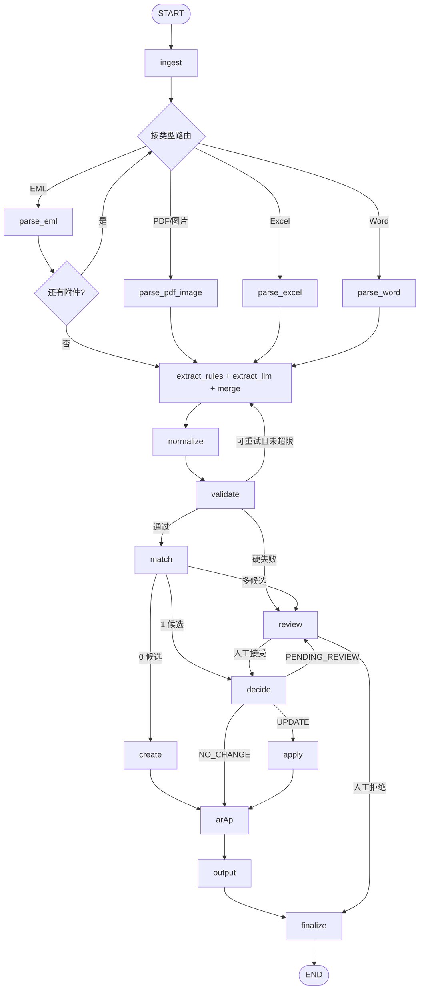

# 工作流图

## 1. 总图



## 2. 状态

`graph/state.py` 的 `AgentState`：

- `pending_files` / `processed_files` / `assets`
- `documents`
- `records` / `issues`
- `matches` / `operations`
- `outputs` / `review_queue` / `review_decisions`
- `retry_counts`
- `errors` / `trace`

列表字段用 `Annotated[list, operator.add]`，字典用自定义 merge 函数。

## 3. 节点职责

| 节点 | 职责 |
|---|---|
| `ingest` | 文件路由、sha256、AssetStore 登记 |
| `parse_*` | EML / PDF·图片 / Excel / Word |
| `extract_rules` | 正则、表头、OCR 字段映射 |
| `extract_llm` | LangChain structured output，含 AR/AP 候选 |
| `merge_extraction` | 双通道合并、冲突标记 |
| `normalize` | 费用名、币种、付款方式 |
| `validate` | 硬/软校验、置信度、去重 |
| `match` | L1–L4 匹配 |
| `decide` | CREATE / UPDATE / NO_CHANGE / PENDING |
| `apply_update` | 字段级合并 |
| `ar_ap` | 主体规则校验 LLM 候选 |
| `output` | 输出投影 + audit_trail |
| `review` | `interrupt()` 人工复核 |
| `finalize` | 输出 JSON / trace / review queue |

## 4. 路由原则

**路由是确定性的，LLM 不决定下一步。**

- `validate`：看 `issues.severity`
- `match`：看候选数量
- `decide`：看字段差异和置信度
- `review`：看人工决定

## 5. 人工复核

- 编译图时挂 `SqliteSaver`；
- `review` 节点调用 `interrupt()`；
- 人工处理后 `Command(resume=...)`；
- `thread_id = run_id`；
- 复核结果写 `review_items` 和 `audit_events`。

## 6. Phase 0

当前只实现：

```text
START → ingest → finalize → END
```

用于验证依赖和状态 reducer。Phase 4 接入完整节点。
